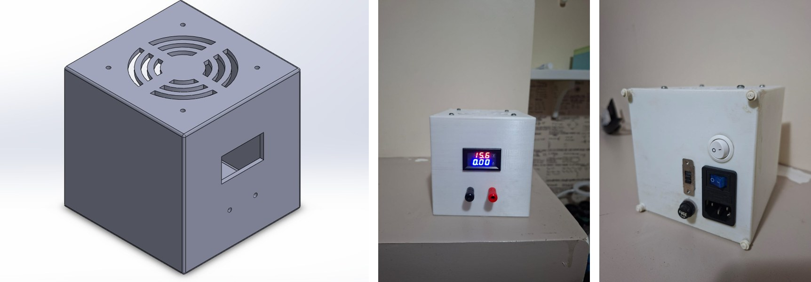

# Electronics Labs

Analog and power electronics lab projects.

| Project | Description | Folder |
|---|---|---|
| Single-phase full-bridge rectifier | Mains power supply from 127 V AC to 12 to 18 V DC, with capacitive filter, PSIM simulation and bench measurements | [single-phase-full-bridge-rectifier](single-phase-full-bridge-rectifier/) |

## Attribution and usage

This repository is shared for portfolio and educational purposes. The rectifier was built with the participation of Gabriela Bosco Azevedo. No license is granted for reuse or redistribution of the images or text. If you want to use any of it, please contact me on [LinkedIn](https://www.linkedin.com/in/felipe-m-k-m-martins).

## Author

Felipe Martins, Mechatronics Engineering student at UTFPR, double degree at ENSTA.
[LinkedIn](https://www.linkedin.com/in/felipe-m-k-m-martins)
