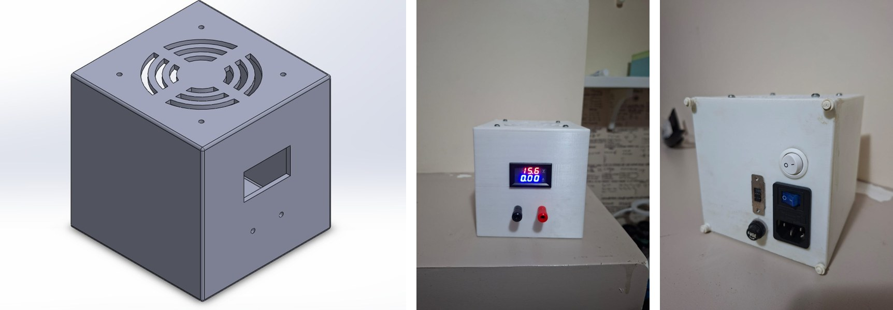
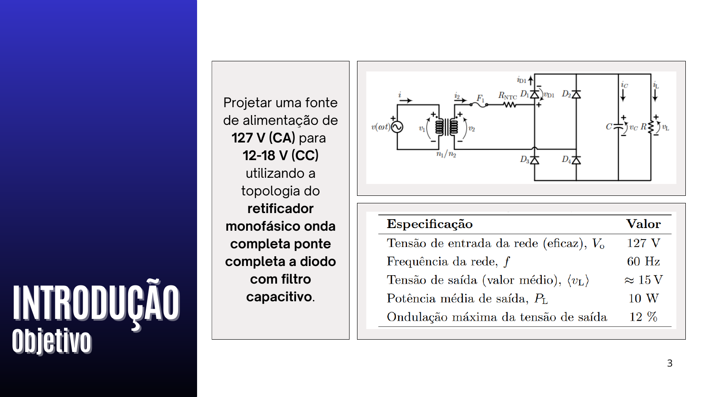
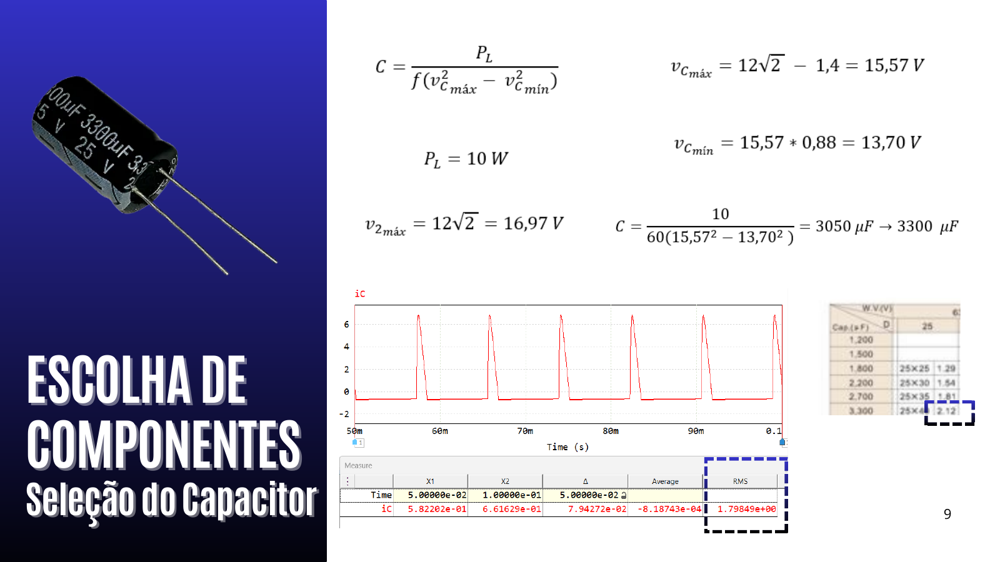
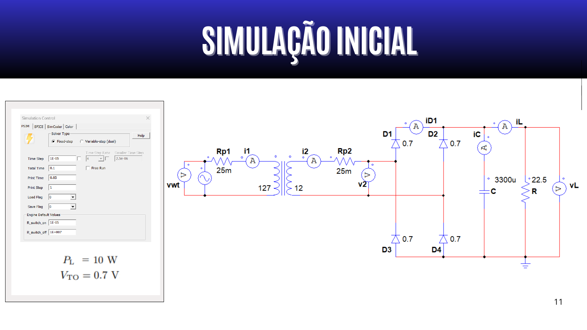
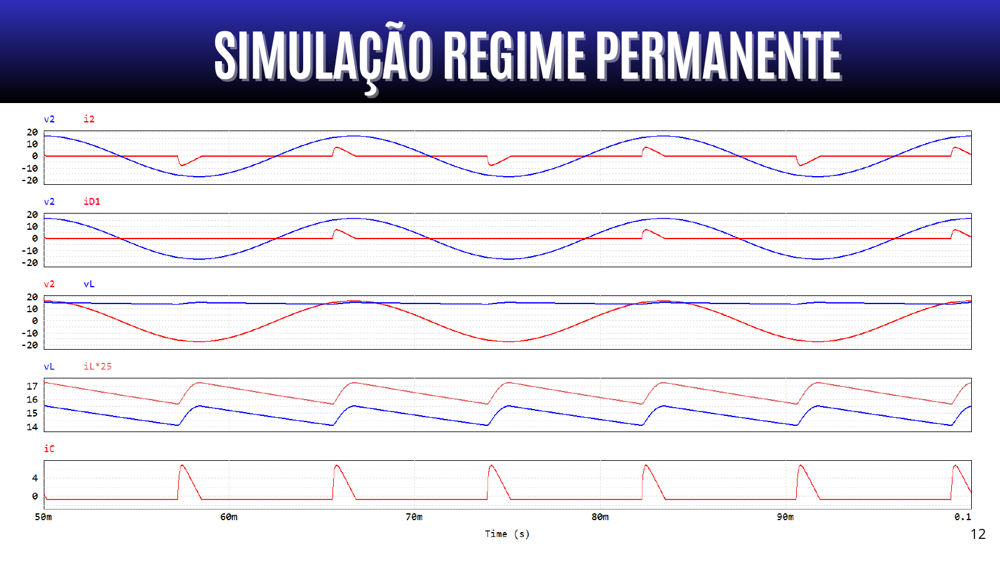
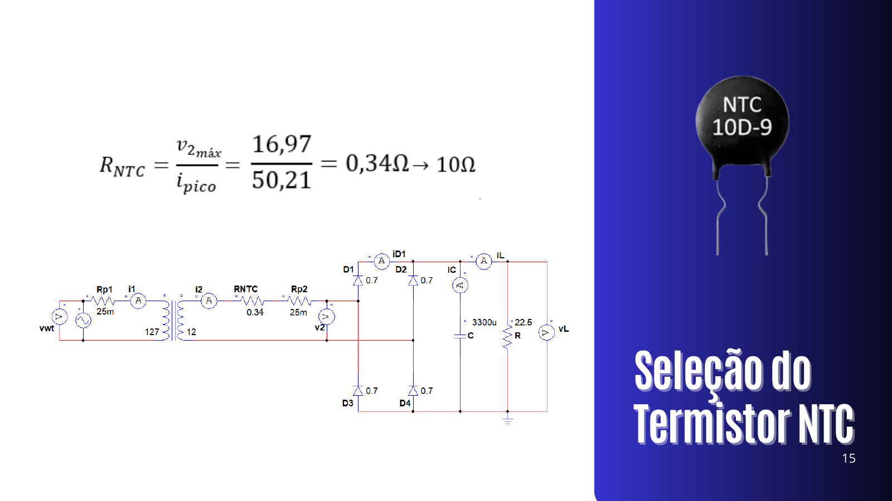
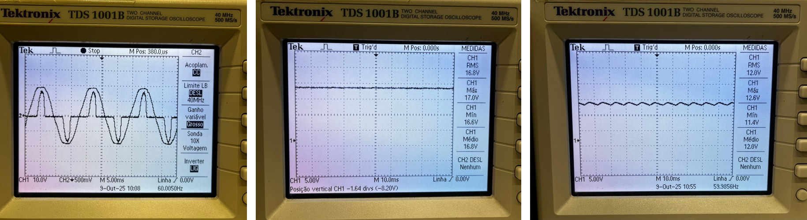

# Single-Phase Full-Bridge Rectifier

Power supply from the 127 V AC mains to a 12 to 18 V DC output: transformer, diode full bridge and capacitive filter, designed, simulated in PSIM, built in an enclosure designed in SolidWorks and measured.

## Overview

The goal was to design a small mains power supply with the classic single-phase full-wave bridge rectifier topology and a capacitive filter, sizing every component from the specification and checking the design in simulation and on the bench. The finished supply has a voltmeter and ammeter on the front, output terminals, and a mains inlet with fuse holder and switch on the back.

## Specification

| Item | Value |
|---|---|
| Input | 127 V AC, 60 Hz |
| Average output voltage | about 15 V |
| Average output power | 10 W |
| Maximum output ripple | 12% |

## Design

| Component | Choice | How it was sized |
|---|---|---|
| Transformer | 127 V to 12 V, 2 A | Secondary peak 12√2 = 16.97 V |
| Diodes | 1N4007 (x4) | Average and peak current from the simulation |
| Filter capacitor | 3300 µF, 25 V | C = P / (f (Vmax² − Vmin²)) with Vmax = 15.57 V and Vmin = 0.88 Vmax = 13.70 V, giving 3050 µF; ripple current checked against the datasheet |
| Fuse | 2 A | RMS current in the secondary |
| Inrush limiter | NTC thermistor 10D-9 (10 Ω) | Simulated inrush peak of about 46 A at start-up |

The steady state and the start-up transient were simulated in PSIM before building.

| Capacitor sizing | PSIM circuit |
|---|---|
|  |  |
| **Steady-state simulation** | **NTC selection** |
|  |  |

Slides are in Portuguese.

## Results

Measured on a Tektronix TDS1001B oscilloscope:

| Condition | Average | Min | Max |
|---|---|---|---|
| With a 22.5 Ω load | 12.0 V | 11.4 V | 12.6 V |
| Without load | 16.8 V | 16.6 V | 17.0 V |

With the 22.5 Ω load the output delivers about 6.4 W (12.0² / 22.5) with 1.2 V peak to peak of ripple, 10% of the average voltage, inside the 12% limit.

## Credits

Project for the Power Electronics A course at UTFPR (2025), with the participation of Gabriela Bosco Azevedo.
